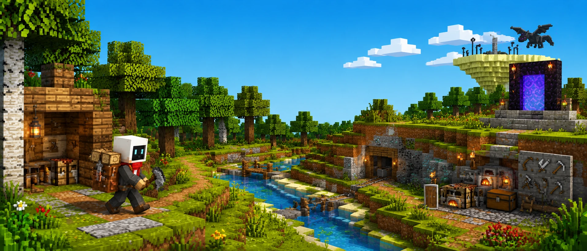
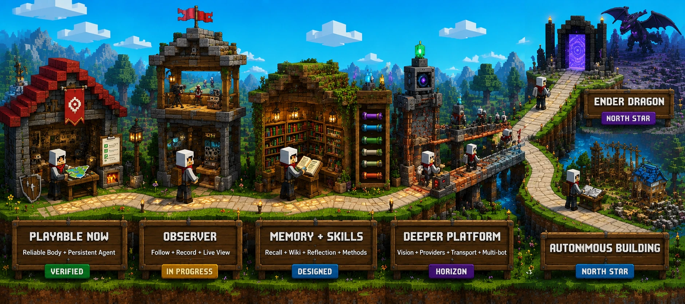

<div align="center">

# MineBot

**Ender Dragon, I will kill you.**

*A Minecraft agent with a mind that can improvise and a body that can be trusted.*




</div>

Tell MineBot what you want in ordinary language. The model chooses a strategy,
the harness keeps the thread, and the configured execution backend does the
physical work. The goal includes playing, helping, building, and accompanying
players; the Ender Dragon is one milestone in that product.

> **You:** Collect 64 logs.<br>
> **MineBot:** reasons, acts, observes, recovers, and keeps going.

## Not A Script Wearing A Chatbot

MineBot puts deterministic machinery where language models are weak: physics,
precise state, long-running execution, ownership, and reflexes. It leaves goals,
trade-offs, and adaptation to the model.

The model chooses from one shared capability pool. The harness preserves task
continuity. The Body handles the grind inside one physical objective. Every
result comes back as structured world truth.

The current Body uses a real Fabric client, upstream Baritone, and native client
actions. Directed disposable-world experiments cover navigation, collection,
crafting, containers, furnaces, melee/ranged combat, vertical work, item handoff,
and Elytra arrival. Java/Carpet FakePlayer remains an available backend;
non-essential self-built navigation expansion is frozen. Product principles
come from [Issue #1](https://github.com/qWaitCrypto/MineBot/issues/1).

The current runtime uses a base-SDK Responses HTTP kernel for asynchronous
physical work and fresh task context. An `openai_responses` provider selects it
by default; `MINEBOT_AGENT_KERNEL=sdk` selects the legacy SDK path. Official
ChatGPT sign-in is available through `minebot-auth login` and
`MINEBOT_LLM_AUTH=chatgpt`; official login and native asynchronous tools have
passed a live experiment with `gpt-6.1-sol`. See
[RUNTIME.md](RUNTIME.md) for the implementation, setup, and actual experiment
result. Success requires observed world state, not command acceptance.

The default Windows view is the real Minecraft window through WSLg, using
`DISPLAY=:0`. No capture, stream, or separate player is needed. Open it with:

```powershell
powershell.exe -NoProfile -ExecutionPolicy Bypass -File .\tools\open-client.ps1 -DisposableWorld
```

This defaults to the local test server `127.0.0.1:25566`, bot `MineBotCombat`,
and IPC port `8768`; use `-Server`, `-Bot`, `-Port`, `-Distro`, or `-Repo` to
change them. Omit `-DisposableWorld` for a non-disposable server. An existing
client is reused rather than launched twice. Xvfb and `watch-client.ps1` remain
optional headless observation tools; they are no longer the desktop default.

## Built To Finish

**Navigate. Gather. Craft. Smelt. Equip. Fight. Recover. Continue.**

The real-client results establish concrete Body capabilities. They do not
establish complete model-driven tasks with conversation and changing goals.
Those are Agent experiments, run through the production entrypoint and checked
against actual inventory, handoff receipts, and position. Historical Java and
Scarpet runs remain evidence for their own scenarios.

## One Mind. One Body. One Source Of Truth.

The Responses path uses the base OpenAI SDK HTTP event stream and a small
model/tool loop. Pending tools keep their original call IDs across responses;
ordinary chat does not cancel their physical execution. Explicit controls
cancel and settle Body work. The old Agents SDK Runner is a separate configured
path, with no automatic fallback after native API failures.

Both paths reuse the existing tool registry and Body transactions. The model
owns goals, short plans, and strategy changes; the Body executes specified
actions and returns real results. The selected backend enforces its control
and mutation boundaries.

```text
minebot/
  brain/      context, lifecycle, progress, capability registry
  app/        persistent runtime and the single composition root
  body/       navigation, work, inventory, crafting, combat, recovery
  game/       real-client IPC, Java Body protocol, governance, debug adapters
  contract/   shared facts and result schemas
  camera/     optional observer supervisor and recording/live fan-out

minecraft/
  client/     real-client Body adapter and upstream Baritone integration
  server/     Fabric Java Body and archived Scarpet regression source
  camera/     observer client and shared Java protocol

tests/        focused regressions and opt-in real task experiments
```

## The Road Gets Stranger



The immediate step is a reproducible real-client + Baritone experiment, followed
by a thin runtime that completes one honest end-to-end task. The project will
then widen the tested conditions. Chat, cooperation, adventure, and building
remain part of the route alongside the Ender Dragon milestone. Engineering is
judged by playable results and measured limits; existing layers are useful
assets, rather than permanent prerequisites for delivery.

## Wake It Up

MineBot currently targets Python 3.13 and a Minecraft 26.1.2 Fabric server with
Carpet plus the MineBot Java Body mod. The Agent process talks to the Body over
WebSocket and does not need RCON credentials.

The contributor gate targets Ubuntu Linux and is developed under WSL2. Native
Windows and macOS are not currently claimed; see [support status](SUPPORT.md).

Build the Body and place the JAR in the server's `mods/` directory alongside
Fabric API and Carpet:

```bash
cd minecraft
./gradlew :server:body:build
cp server/body/build/libs/minebot-body-0.1.0.jar /path/to/server/mods/
cd ..
```

Start the server, then prepare MineBot:

```bash
python3.13 -m venv .venv
source .venv/bin/activate
python3 -m pip install -e .

# Anthropic, Gemini, and other LiteLLM-backed providers:
# python3 -m pip install -e ".[litellm]"

export MINEBOT_LLM_MODEL=<model>
export MINEBOT_LLM_API_KEY=<key>
# Optional for an OpenAI-compatible endpoint:
export MINEBOT_LLM_BASE_URL=<https://host/v1>
export MINEBOT_REAL_BOT=Bot1
export MINEBOT_JAVA_BODY_URL=ws://127.0.0.1:8767

python3 -m minebot.app.real_server_session --interactive
```

Anthropic Messages is a first-class provider and uses the same Agents SDK
runtime through a native Messages adapter. It does not use ChatGPT OAuth or an
OpenAI-compatible shim:

```bash
export MINEBOT_LLM_KIND=anthropic_messages
export MINEBOT_LLM_MODEL=claude-sonnet-4-5
export ANTHROPIC_API_KEY=<key>
# Optional reasoning depth: none, minimal, low, medium, high, or xhigh.
# Anthropic receives this as output_config.effort (minimal is mapped to low).
# export MINEBOT_LLM_REASONING_EFFORT=medium
# Optional custom Anthropic-compatible gateway:
# export MINEBOT_LLM_BASE_URL=https://host/v1
# Enable Anthropic prompt-cache breakpoints on the stable system/tool prefix:
# export MINEBOT_LLM_PROMPT_CACHE=true   # Anthropic Messages: on by default, false disables
# export MINEBOT_LLM_PROMPT_CACHE_TTL=5m   # 5m or 1h
```

`anthropic_messages` selects the legacy Agents SDK kernel because the native
Responses kernel speaks OpenAI's Responses wire protocol. The adapter converts
the shared Responses input/tool representation to Anthropic Messages, including
text, data/URL images, tool use/results, streaming events, and prompt-cache
breakpoints; Body execution and tool ownership remain in the existing runtime.

For the managed local golden-world environment, start the server reset, provider
preflight, Camera, trace/state directory, and production interactive session with
one command:

```bash
minebot-local
```

The launcher uses the local test server defaults and your existing provider
environment. For a persistent private provider profile, run `minebot-local
--init` once and fill `~/.config/minebot/runtime.env`; initialize the optional
observer once with `minebot-camera init`.

`minebot-local` resets only a loopback test server and enables Camera by
default. The launcher may use loopback RCON in its external reset step, but it
removes every RCON variable before starting the Java-only Agent child. Use
`--no-reset` to preserve the current local world or `--no-camera` on machines
without the observer stack. Remote servers use the explicit
`minebot.app.real_server_session` entrypoint and are never reset by the launcher.

Then talk to it:

```text
minebot> collect 3 dirt
minebot> follow me
minebot> what happened while I was away?
```

The old `minebot.app.console`, Scarpet app, and RCON client remain available for
legacy directed debugging only. They are not loaded by the production entrypoint.

Run the fast behavioral regression used by CI with:

```bash
python3 -m pytest
```

For directed Body tasks and real model Agent experiments, see
[Testing](TESTING.md). Run other existing test files explicitly when changing
their subsystem; a full historical suite is not the default feedback loop.

## Make It More Reliable

Contributions are not limited to code. Reproducible failures, evaluation scenes,
traces, compatibility fixes, and clear documentation all make MineBot stronger.
Start with [Contributing](CONTRIBUTING.md), then check the current
[support matrix](SUPPORT.md). A stable failure case is a complete contribution,
even without a fix.

MineBot is released under the [MIT License](LICENSE). Minecraft is a trademark
of Microsoft. MineBot is independent and is not affiliated with Mojang Studios
or Microsoft.
