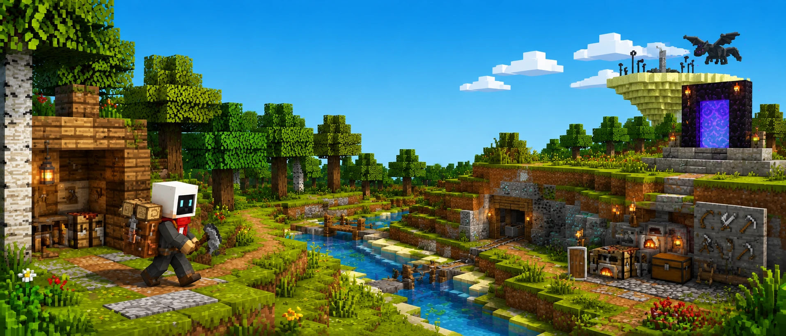
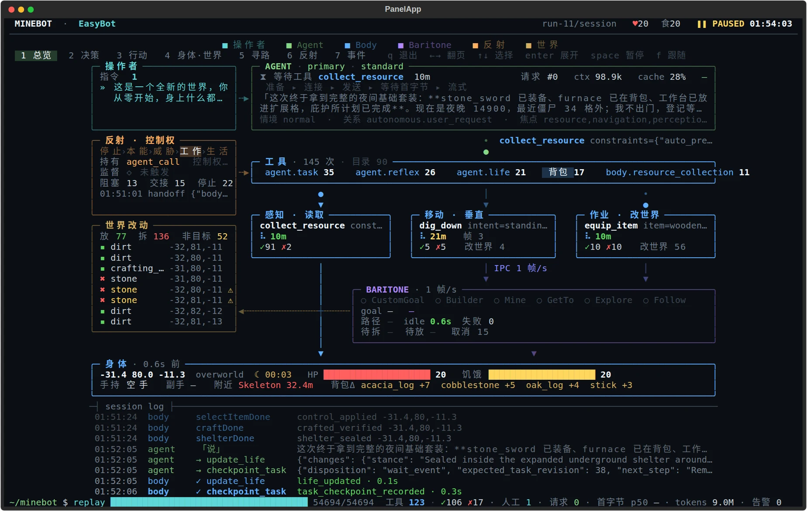
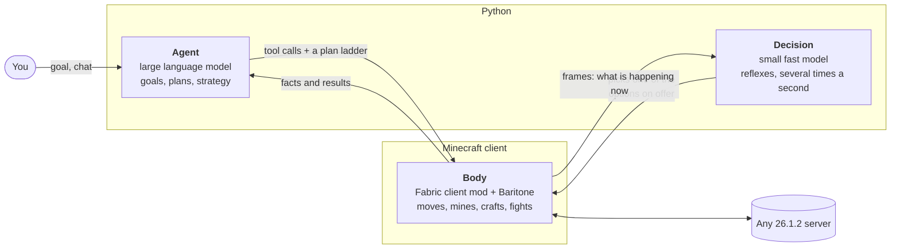
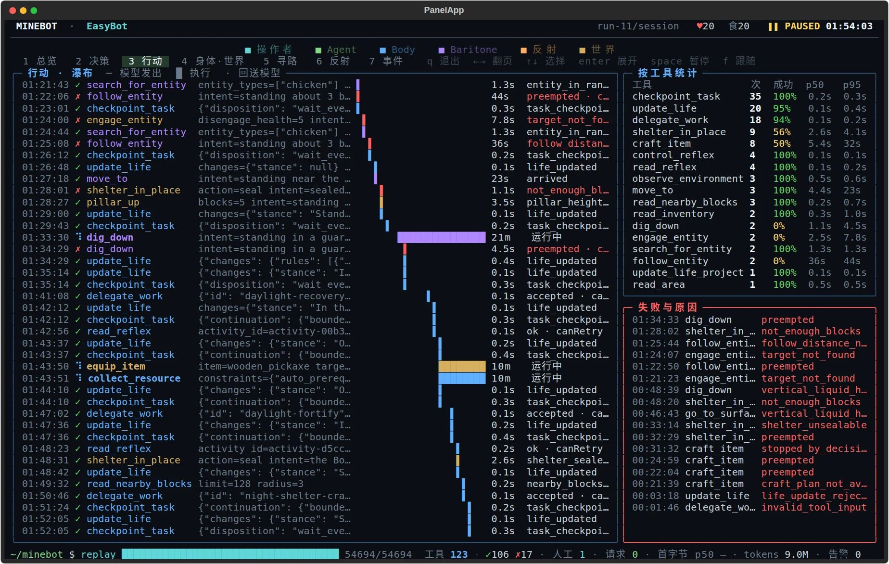

<div align="center">

# MineBot

**Ender Dragon, I will kill you.**

*A Minecraft survival agent that plays through a real game client:
a language model that thinks, a fast model that reacts, and a body that tells the truth.*




</div>

MineBot joins a Minecraft server as an ordinary player and tries to survive and
progress the way a person would: gather, craft, build a shelter, get through the
night, go to the Nether, and one day fight the Ender Dragon. You give it a goal
in plain language and watch it work in a live terminal panel.



> **Status: developer preview.** In a fresh survival world on *easy*, MineBot
> gets wood, stone and iron tools, food, a shelter and a bed, and has reached the
> Nether on its own. It still dies more often than a good player does, especially
> at night. The Ender Dragon is the goal, not yet an achievement.

## How it works

Three layers, each doing what it is good at:



- **Agent**: a large language model (any OpenAI-compatible, Anthropic, or
  LiteLLM provider). It sets goals, writes a *plan ladder* of standing items
  ("when dusk comes and I am outside, go home and sleep"), reads *skills*
  (play knowledge in [`minebot/skills/catalog`](minebot/skills/catalog)), and
  calls Body tools. It thinks in seconds to tens of seconds.
- **Decision**: a small, fast model that sees a frame of what is happening right
  now and picks one of a few concrete options: keep working, dodge, fight back,
  run, call the Agent. This is the reflex layer that keeps the Body alive
  between the Agent's turns. See [The Decision service](#the-decision-service).
- **Body**: a real Minecraft client with a Fabric mod and a patched
  [Baritone](https://github.com/cabaletta/baritone). It executes actions and
  reports what really happened (blocks broken, items gained, damage taken). A
  model saying "done" never counts; only observed world state does.

Nothing MineBot-specific runs on the server. The bot is a normal player, so it
works on any server its account can join.

## Requirements

| | |
|---|---|
| OS | Linux. Developed on Ubuntu 24.04 and on WSL2 (Windows). macOS is untested. |
| Python | 3.13 |
| Java | 25 (for the game client), plus Git |
| Display | The client is a real game window: a desktop session, WSLg, or Xvfb for headless runs |
| Server | A Minecraft **26.1.2** server. Vanilla works. Use `online-mode=false` for offline bot names. |
| Agent model | An API key for an LLM provider (see [Configuration](#configuration)) |
| Decision model | Optional, but strongly recommended (see [below](#the-decision-service)) |

## Quick start

**1. Install MineBot**

```bash
git clone https://github.com/qWaitCrypto/MineBot.git
cd MineBot
python3.13 -m venv .venv
source .venv/bin/activate
pip install -e .
```

**2. Build the client Body once**

The first build downloads Minecraft, Fabric and Baritone's sources, applies
MineBot's Baritone patch, and compiles everything. It takes a few minutes; later
starts reuse the result.

```bash
cd minecraft && ./gradlew :client:body:build && cd ..
```

**3. Start a server**

Any 26.1.2 server works. For a local test world, download the official server
jar, accept the EULA, and set `online-mode=false` in `server.properties` so the
bot can join with an offline name:

```bash
java -jar server.jar nogui        # first run writes eula.txt and server.properties
```

**4. Configure the model**

Create `~/.config/minebot/runtime.env`:

```bash
MINEBOT_LLM_KIND=openai_chat               # any OpenAI-compatible Chat Completions API
MINEBOT_LLM_MODEL=<model name>
MINEBOT_LLM_BASE_URL=https://<host>/v1
MINEBOT_LLM_API_KEY=<your key>
MINEBOT_AGENT_LANGUAGE=English             # the bot's speech; default is Chinese
# MINEBOT_DECISION_URL=http://127.0.0.1:10004/v1/systemone
```

**5. Add the server and check everything**

```bash
minebot servers add local 127.0.0.1:25565 --account MineBot --world disposable --default
minebot doctor
```

`--world disposable` lets the bot dig and build freely; it is allowed only for a
server on this machine. `protected` refuses every world-changing tool.

**6. Go**

```bash
minebot "Survive your first night, then get iron tools."
```

`minebot` checks the environment, account and server, starts the game client,
waits for the bot to enter the world, starts the Agent, and turns into the live
panel. Type in the panel to talk to the bot.

## The panel

The panel is the main way to watch and steer MineBot. It reads the session's
trace, so you can also replay any past session.



| Page | What it shows |
|---|---|
| 1 Overview | Operator, Agent, reflexes, tool lanes, Baritone and the Body in one flow |
| 2 Decision | Model requests by phase, token and cache use, what the Agent said |
| 3 Actions | Every tool call on a timeline, per-tool statistics, recent failures |
| 4 Body / World | Position, health, inventory, the blocks the bot changed |
| 5 Pathing | Baritone goals, paths and failures |
| 6 Reflex | Decision frames, the options offered and the choice made |
| 7 Events | The raw event stream |

Keys: `←`/`→` or `Tab` switch pages, `↑`/`↓` select, `Enter` expands, `Space`
pauses the view, `f` follows the newest event, `:` opens the command bar, `q`
quits.

The bot keeps running when the panel closes:

```bash
minebot attach            # reopen the panel on the running bot (Ctrl+D detaches again)
minebot attach --list     # running sessions
minebot-panel logs/sessions/<run>   # replay a finished session
```

Each session writes its trace, Agent log and client log under `logs/sessions/`.

> The panel and launcher text is currently Chinese.

## Configuration

`minebot` reads `~/.config/minebot/runtime.env` (or `--env-file`), and command
line flags override it. Server profiles live in `~/.config/minebot/servers.toml`
(`minebot servers --help`).

**Agent model**

| Variable | Meaning |
|---|---|
| `MINEBOT_LLM_KIND` | `openai_chat` (default), `openai_responses`, `anthropic_messages`, or `litellm` |
| `MINEBOT_LLM_MODEL` | Model name |
| `MINEBOT_LLM_BASE_URL` | API base URL for OpenAI-compatible or custom gateways |
| `MINEBOT_LLM_API_KEY` | API key (`ANTHROPIC_API_KEY` also works for `anthropic_messages`) |
| `MINEBOT_LLM_REASONING_EFFORT` | `none` … `xhigh`, for models that support it |
| `MINEBOT_LLM_PROMPT_CACHE` | Prompt caching for Anthropic (on by default) |

For `litellm` providers (Gemini and others) install the extra:
`pip install -e ".[litellm]"`. To use a ChatGPT subscription instead of an API
key, run `minebot-auth login` and set `MINEBOT_LLM_AUTH=chatgpt`.

**Bot and world**

| Variable | Meaning |
|---|---|
| `MINEBOT_AGENT_LANGUAGE` | Language the bot speaks (default `Chinese`) |
| `MINEBOT_DECISION_URL` | The Decision service endpoint |
| `MINEBOT_CLIENT_LAUNCH` | Command that starts the game client (default `tools/open-client.sh`) |
| `MINEBOT_AGENT_STATE_DB` | Where the bot's memory lives (default `var/minebot/agent-state.sqlite3`, kept across sessions) |

**Accounts.** An offline name works on servers with `online-mode=false`. For an
official server, `minebot login <name>` signs the bot's own Microsoft account in
with a device code. Mojang only accepts Azure app registrations it has approved
for the Minecraft API, so this needs your own approved client id in
`MINEBOT_MSA_CLIENT_ID`. MineBot never stores your personal account.

## The Decision service

The reflex layer sends each frame as a small JSON request
(`{"state": {...}, "questions": {...}}`) to `MINEBOT_DECISION_URL` and expects a
JSON answer naming the chosen option. It must answer in well under a second; we
run a 9B instruction model behind it.

The service itself is not part of this repository yet. Without it, MineBot still
runs: every reflex question goes unanswered, the Body carries out the Agent's
calls, and nothing reacts between the Agent's turns. Expect many more deaths on
any difficulty above peaceful.

## Repository layout

```text
minebot/
  shell/      the `minebot` command: launcher, supervisor, accounts, server profiles
  panel/      the terminal panel (Textual)
  app/        Agent runtime, reflex layer (Decision frames), Body loop, sessions
  brain/      persona, context, model providers
  body/       Body tools: navigation, gathering, crafting, combat, recovery
  game/       client IPC, world-safety governance
  skills/     play knowledge the Agent reads (Markdown)
  contract/   shared fact and result schemas
minecraft/
  client/body/  the Fabric client mod and the Baritone patch
tools/        launch helpers, Decision replay, evaluation scripts
tests/        unit tests and recorded fixtures
```

## Development

```bash
pip install -e ".[test]"
python -m pytest              # the fast regression gate that CI runs
python -m pytest tests/unit/test_<area>.py   # the tests for what you changed
```

The full unit suite is large; run the files for the area you touch.

Good first contributions:

- **A reproducible failure**: a world seed, a goal, and the session trace where
  the bot did something a player would not. This is a complete contribution
  even without a fix.
- **Skills**: better play knowledge in `minebot/skills/catalog/*/SKILL.md`.
- **Platform fixes**: macOS, other distributions, other display setups.

See [CONTRIBUTING.md](CONTRIBUTING.md) before larger changes.

## License

MineBot is released under the [MIT License](LICENSE). It builds
[Baritone](https://github.com/cabaletta/baritone) (LGPL-3.0) from source with a
small patch in [`minecraft/client/body/baritone-patches`](minecraft/client/body/baritone-patches).

Minecraft is a trademark of Microsoft. MineBot is an independent project and is
not affiliated with Mojang Studios or Microsoft.
